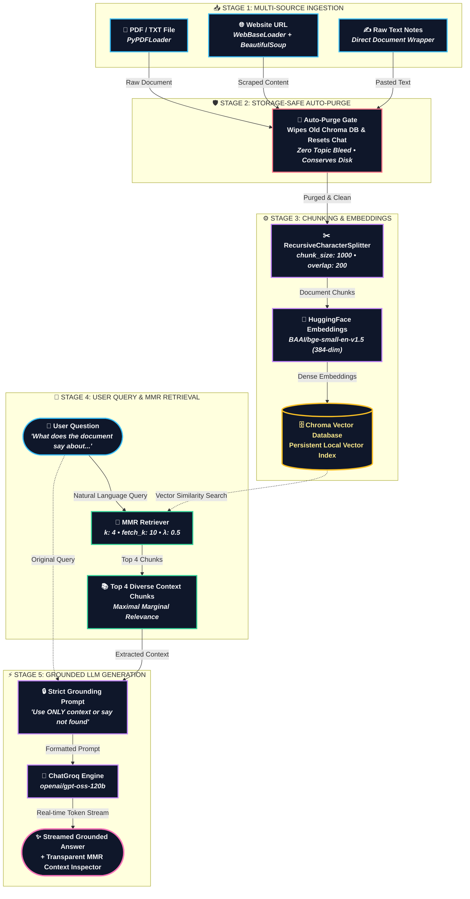

<div align="center">

# 🤖 SmartMate 💖
### *Your Friendly, Multi-Source Conversational RAG Companion*

[](https://www.python.org/)
[](https://streamlit.io/)
[](https://www.langchain.com/)
[](https://www.trychroma.com/)
[](https://groq.com/)
[](https://huggingface.co/BAAI/bge-small-en-v1.5)

<br/>

> **"Upload anything you want — PDF, Web URL, or raw text — and immediately start having insightful, grounded conversations."** ✨

---

</div>

## 🌸 Table of Contents

- [✨ What is SmartMate?](#-what-is-smartmate)
- [🎯 Key Features](#-key-features)
- [🧠 The RAG Workflow & Pipeline](#-the-rag-workflow--pipeline)
- [🛡️ Storage-Safe Auto-Purge Engine](#️-storage-safe-auto-purge-engine)
- [🛠️ Tech Stack](#️-tech-stack)
- [🚀 Quick Start Guide](#-quick-start-guide)
- [⚙️ Environment Configuration](#️-environment-configuration)
- [📂 Project Structure](#-project-structure)
- [💡 Example Use Cases](#-example-use-cases)
- [🎀 Pro Tips & UI Guide](#-pro-tips--ui-guide)

---

## ✨ What is SmartMate?

**SmartMate** is a modern, modular Retrieval-Augmented Generation (RAG) web application crafted for deep, accurate document chat.

Whether you have a **dense research PDF**, a **fascinating tech blog article**, or **quick meeting notes pasted directly into the app**, SmartMate instantly ingests, chunks, embeds, and indexes your material so you can ask anything and receive precise, strictly-grounded answers powered by ultra-fast LLMs.

---

## 🎯 Key Features

| Feature | Description |
| :--- | :--- |
| **📄 Multi-Format File Ingestion** | Upload any `.pdf` or `.txt` file effortlessly with drag-and-drop support. |
| **🌐 Live Web Page Scraping** | Provide any public website or article URL to fetch, clean, and chat with online knowledge. |
| **✍️ Direct Text Scratchpad** | Paste raw snippets, meeting minutes, or code notes directly into the UI without creating files. |
| **🧹 Storage-Safe Auto-Purge** | Ingesting a new source **automatically wipes old embeddings and vector store files** from disk and memory to prevent topic bleed and conserve storage! |
| **🎯 High-Precision MMR Retrieval** | Uses **Maximal Marginal Relevance (MMR)** (`k=4`, `fetch_k=10`, `lambda_mult=0.5`) to eliminate redundancy and return diverse, high-signal context chunks. |
| **🔒 Strictly Grounded Answers** | Governed by an intelligent prompt template: answers strictly using verified context, or honestly says *"I could not find the answer in the document."* |
| **🔍 Transparent Context Inspector** | Every response includes an expandable **"View Retrieved MMR Context"** viewer, letting you see the exact chunks and source metadata behind every answer. |
| **⚡ Ultra-Low Latency Inference** | Powered by **Groq** (`openai/gpt-oss-120b`, `llama-3.3-70b-versatile`, `mixtral-8x7b-32768`) for near-instant responses. |

---

## 🧠 The RAG Workflow & Pipeline

<div align="center">


*Figure 1: SmartMate End-to-End System Diagram — Multi-Source Ingestion, Storage-Safe Purge, MMR Vector Search & ChatGroq Streaming*

</div>

<br/>

### 📦 Interactive Workflow Graph (Boxes & Arrows)



<br/>

### 📐 Visual ASCII Blueprint

```text
┌────────────────────────────────────────────────────────────────────────────────────────┐
│                              🧠 SMARTMATE RAG ARCHITECTURE                             │
└────────────────────────────────────────────────────────────────────────────────────────┘

  [STAGE 1: INPUT]                 [STAGE 2: PURGE]                  [STAGE 3: INDEXING]
 ┌──────────────────────┐        ┌───────────────────────┐        ┌───────────────────────┐
 │ 📄 PDF / TXT File    │        │  🛡️ Auto-Purge Gate   │        │ ✂️ Splitter (1000/200)│
 │ 🌐 Website URL       │ ─────► │  • Delete Old Chroma  │ ─────► │ 🧮 BGE Embeddings     │
 │ ✍️ Raw Text Notes    │        │  • Reset Chat History │        │ 🗄️ Chroma Vector DB   │
 └──────────────────────┘        └───────────────────────┘        └───────────┬───────────┘
                                                                              │
 ─────────────────────────────────────────────────────────────────────────────┼───────────
                                                                              │
  [STAGE 4: QUERY]                 [STAGE 5: MMR RETRIEVAL]          [STAGE 6: GENERATION]
 ┌──────────────────────┐        ┌───────────────────────┐        ┌───────────▼───────────┐
 │ 👤 User Question     │        │ 🎯 MMR Retriever      │        │ 🔒 Strict Prompt      │
 │  "Ask anything..."   │ ─────► │  • k=4, fetch_k=10    │ ─────► │ ⚡ ChatGroq LLM       │
 │                      │        │  • lambda=0.5         │        │ ✨ Grounded Answer    │
 └──────────────────────┘        └───────────────────────┘        └───────────────────────┘
```

---

## 🛡️ Storage-Safe Auto-Purge Engine

> [!IMPORTANT]
> **Why Auto-Purge?**
> In traditional RAG setups, uploading multiple documents continuously appends embeddings to the same database. This leads to:
> 1. **Topic Contamination**: Answering questions with fragments from older, unrelated uploads.
> 2. **Disk Bloat**: Vector store folders quickly taking hundreds of megabytes on disk.
> 3. **Memory Pressure**: Unnecessary embedding caches staying active.

SmartMate solves this with **Automatic Source Isolation**:
- Whenever you upload a new file, URL, or text, SmartMate invokes `clear_vector_store()`.
- It deletes the previous Chroma collection and wipes the temporary disk storage.
- It refreshes your conversation history so your chat starts clean and focused exclusively on the new topic.
- You can also hit **"🗑️ Delete Current Knowledge Base"** in the sidebar whenever you want to wipe memory manually!

---

## 🛠️ Tech Stack

```text
Frontend UI/UX  ───► Streamlit (Interactive Chat, Sidebar Ingestion, Context Viewers)
RAG Orchestration ─► LangChain Community & Core
Embedding Model ──► BAAI/bge-small-en-v1.5 (Local Hugging Face Embeddings)
Vector Store    ───► ChromaDB (Local Persistent & Purge-Safe)
LLM Provider    ───► Groq (High-Speed API)
Document Parsers ──► PyPDF, BeautifulSoup4, WebBaseLoader
Language        ───► Python 3.13
Environment     ───► UV / Virtualenv (.venv)
```

---

## 🚀 Quick Start Guide

### 1. Prerequisites

Ensure you have **Python 3.13+** installed on your system.

### 2. Navigate to SmartMate

Open your terminal (PowerShell or Command Prompt) and switch to the project folder:

```powershell
cd C:\Users\gedal\Desktop\AI\RAG\SmartMate
```

### 3. Configure Your `.env` File

Create or verify the `.env` file inside the `SmartMate/` directory with your Groq API key:

```env
GROQ_API_KEY="your_groq_api_key_here"
```

*(Optional: You can also specify `MISTRAL_API_KEY`, `OPENAI_API_KEY`, or `GOOGLE_API_KEY` if you wish to use alternative providers.)*

### 4. Run the Streamlit Application

Launch SmartMate directly using the project's virtual environment:

```powershell
.venv\Scripts\streamlit run app.py
```

*Or via python:*

```powershell
.venv\Scripts\python -m streamlit run app.py
```

Your browser will automatically open to:
👉 **`http://localhost:8501`** 🎉

---

## ⚙️ Environment Configuration

| Variable | Required | Description |
| :--- | :---: | :--- |
| `GROQ_API_KEY` | **Yes** | Your API key from [Groq Console](https://console.groq.com/) for ultra-fast generation. |
| `TRANSFORMERS_OFFLINE` | Auto | Set to `1` by `rag_engine.py` to prevent unnecessary model re-downloads. |
| `HF_HUB_OFFLINE` | Auto | Set to `1` by `rag_engine.py` for rapid, offline embedding loading. |

---

## 📂 Project Structure

```text
SmartMate/
├── app.py                   # 🎨 Streamlit Web UI/UX (File / URL / Text Ingestion + Chat)
├── rag_engine.py            # 🧠 Core RAG engine (loaders, Chroma lifecycle, MMR, LLM)
├── requirements.txt         # 📋 List of Python dependencies
├── .env.example             # 🔑 Template for required API keys
├── .gitignore               # 🛡️ Git protection rules (protects .env & storage)
├── README.md                # 💖 Documentation & architecture guide
└── assets/                  # 📊 Visual architecture assets
    └── rag_workflow.svg
```

---

## 💡 Example Use Cases

- 📚 **Study & Exam Preparation**: Upload class notes or textbook chapters (`.pdf`) and ask SmartMate to explain complex theorems, generate quiz questions, or summarize key takeaways.
- 📰 **Tech Article & Blog Digest**: Paste a link to a long technical article or documentation page and ask: *"What are the 3 main takeaways and trade-offs mentioned?"*
- 📝 **Meeting Summaries**: Paste raw meeting transcripts or project briefs into the **Raw Text** tab and chat directly with action items, deadlines, and responsibilities.

---

## 🎀 Pro Tips & UI Guide

- **Verify Your Context**: Check the **"📚 View Retrieved MMR Context"** expander beneath each answer to inspect the exact document passages SmartMate relied on.
- **Switch Models on the Fly**: Use the **⚙️ Settings** dropdown in the sidebar to switch between `openai/gpt-oss-120b`, `llama-3.3-70b-versatile`, or `mixtral-8x7b-32768`.
- **Clean Slate Anytime**: Hit the red **"🗑️ Delete Current Knowledge Base"** button whenever you want to wipe memory completely and start fresh.

---

<div align="center">

Made with 💖 by **SmartMate Team** • Built with **LangChain & Streamlit**

</div>
